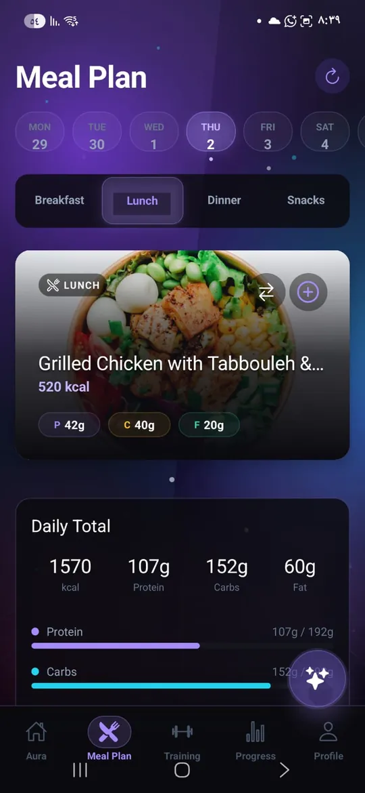
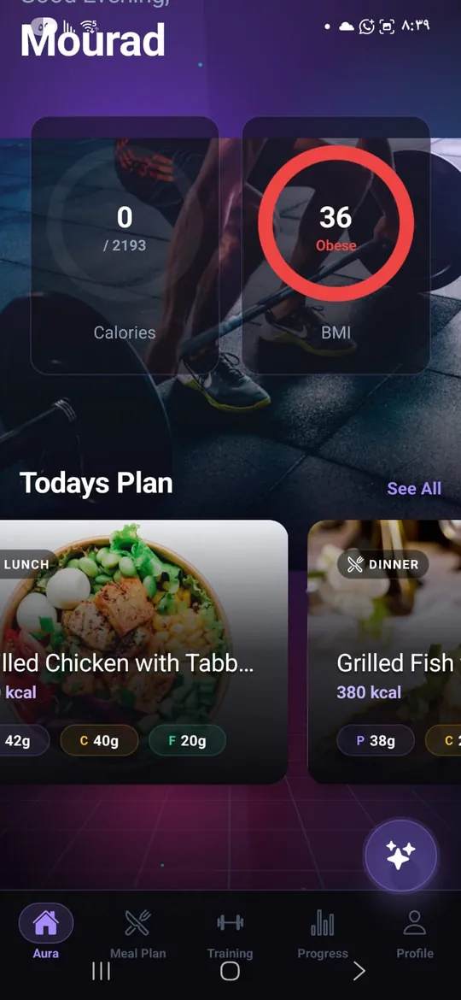
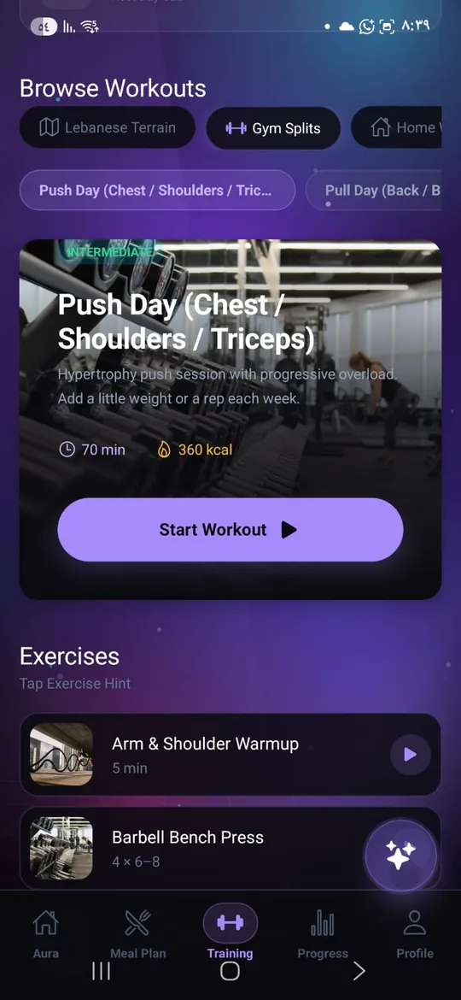

# AuraFit

A fitness and nutrition mobile app: daily meal plans with macros, guided workout splits, and a live calorie and BMI dashboard, in English, Arabic, and French.





## Features
- Meal plans by day and meal, with protein, carbs, and fat totals.
- Workout splits with exercise lists.
- Calorie and BMI dashboard.
- Three languages (English, Arabic, French) with right-to-left support.
- Packaged for **Android and iOS** with Capacitor.

## Stack
React 18 · Vite 5 · Tailwind CSS 3 · Framer Motion · Capacitor 6

## Run it
```bash
npm install
npm run dev                                  # web preview
npm run build && npx cap sync android        # then open android/ in Android Studio
```
